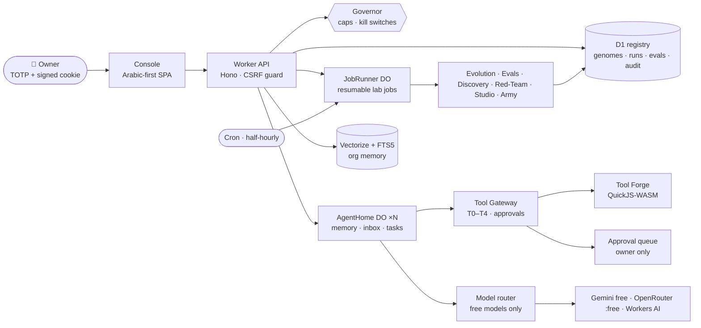

<p align="center">
  <picture>
    <source media="(prefers-color-scheme: dark)" srcset=".github/assets/hero-dark.svg">
    <source media="(prefers-color-scheme: light)" srcset=".github/assets/hero-light.svg">
    
  </picture>
</p>

<p align="center">
  <a href="README.md">العربية</a> &nbsp;·&nbsp; <b>English</b>
</p>

<p align="center">
  
  
  
  
  
  
</p>

<p align="center">
  <picture>
    <source media="(prefers-color-scheme: dark)" srcset=".github/assets/tagline-dark.svg">
    <source media="(prefers-color-scheme: light)" srcset=".github/assets/tagline-light.svg">
    
  </picture>
</p>

<p align="center">
  <picture>
    <source media="(prefers-color-scheme: dark)" srcset=".github/assets/stats-dark.svg">
    <source media="(prefers-color-scheme: light)" srcset=".github/assets/stats-light.svg">
    
  </picture>
</p>

> [!NOTE]
> **Khaliya is in development.** The service is not open to the public: the console is owner-only (TOTP sign-in), and there is no sign-up, no sales and no payments. This repository shows the code and the design.

## What is Khaliya?

**Khaliya** (Arabic for *beehive / cell*) is a web platform that hosts **a whole organization of AI agents**. Every agent has a **home** (a Durable Object with its memory, inbox, tasks and traces), a **genome** (immutable, SHA-256-addressed JSON config), tools and a budget.

Agents **propose new agents and better versions of themselves**. Every candidate is tested in a sandbox, then competes in a Glicko-2 tournament, and is promoted only if it beats the incumbent, behind a canary with automatic rollback.

> **Evolution has no ceiling — promotion has a gate.** Every run has hard caps, and any external action or spend needs the owner's approval.

Everything runs on **Cloudflare's free tiers** (Workers, D1, Durable Objects, Workers AI, Vectorize) and calls **free models only** (Gemini free tier, OpenRouter `:free`, Workers AI).

<p align="center"></p>

## Features

<table>
<tr>
<td width="33%" valign="top"><br><b>Agent homes</b><br><sub>One Durable Object per agent: memory, inbox, tasks, thought trace; loop perceive → retrieve → plan → act → reflect.</sub></td>
<td width="33%" valign="top"><br><b>Genomes</b><br><sub>Immutable configs with <code>g_</code> + SHA-256 ids, re-verified on every load. Rollback is a pointer swap.</sub></td>
<td width="33%" valign="top"><br><b>Evolution loop</b><br><sub>Thompson-sampled mutation operators, Glicko-2 tournaments, canaries, promote or auto-rollback — as resumable background jobs.</sub></td>
</tr>
<tr>
<td valign="top"><br><b>Eval Factory</b><br><sub>Suites with programmatic checkers and a two-model judge panel; saturation and flaky-item detection.</sub></td>
<td valign="top"><br><b>Tool Forge</b><br><sub>Agents write their own tools in a QuickJS-WASM sandbox; each tool passes 7 admission gates before anyone may use it.</sub></td>
<td valign="top"><br><b>Discovery Lab</b><br><sub>23 machine-verifiable problems (Golomb rulers, Ramsey, Sidon sets…); certificates need two independent re-verifications.</sub></td>
</tr>
<tr>
<td valign="top"><br><b>Red-Team Arena</b><br><sub>Injection and jailbreak attacks on agents, tools and evaluators; every breach becomes a new test.</sub></td>
<td valign="top"><br><b>Org memory</b><br><sub>Hybrid knowledge base (Vectorize + FTS5) with light Arabic stemming and lessons distilled from failures.</sub></td>
<td valign="top"><br><b>Judge Court</b><br><sub>Measures each judge model's position consistency and self-preference, and weights its vote by reliability.</sub></td>
</tr>
<tr>
<td valign="top"><br><b>Agent Studio</b><br><sub>Arabic brief → genome → safety block → private eval vs strong and weak baselines. No promotion unless every safety task passes.</sub></td>
<td valign="top"><br><b>Agent Army</b><br><sub>9 divisions, ranks R0–R4, HMAC-signed passports and capability tokens, autonomy ladder L0–L5, mission contracts with a mandatory rollback plan.</sub></td>
<td valign="top"><br><b>Governor & constitution</b><br><sub>Daily caps from free-tier quotas × 70%, kill switches, hash-chained audit log. No agent can edit any of it.</sub></td>
</tr>
</table>

<p align="center"></p>

## Architecture



<p align="center">
  <picture>
    <source media="(prefers-color-scheme: dark)" srcset=".github/assets/evolution-loop-dark.svg">
    <source media="(prefers-color-scheme: light)" srcset=".github/assets/evolution-loop-light.svg">
    
  </picture>
</p>

## Evolution & the safety Governor

1. **Propose** — a mutation operator (picked by Thompson sampling) produces a new genome from one or two parents.
2. **Sandbox eval** — the candidate runs the private split of its suites, safety tasks included. External tools are simulated; no network.
3. **Tournament** — matches against the champion, rated with Glicko-2 and ranked by the conservative score `r − 2·RD`.
4. **Canary** — a small live sample; any regression moves the pointer back automatically.
5. **Promote or rollback** — an audited deployment-pointer move. Notes from every round feed back into the mutators.

| Tier | Allowed | Approval |
|---|---|---|
| **T0** | thinking, own memory | automatic |
| **T1** | internal org tools | automatic, within budget |
| **T2** | sandboxed code | automatic, within budget |
| **T3** | external read | owner approval |
| **T4** | external write / spend / publish | owner approval + fresh TOTP code |

- **Per-run caps:** 12 steps, 24k tokens, 8 tool calls, 16 LLM calls, 90 s (a genome can only lower them).
- **Kill switches:** global, per agent and per division — checked before every step and inside the Tool Gateway; auto-pause after 5 failed runs in an hour.
- **Separation of powers:** no agent evaluates its own candidate; Evaluator, Critic and Auditor lineages are protected from the agents they judge.
- **Audit log:** append-only and hash-chained, verifiable at `/api/audit/verify`.

<p align="center">
  <picture>
    <source media="(prefers-color-scheme: dark)" srcset=".github/assets/army-dark.svg">
    <source media="(prefers-color-scheme: light)" srcset=".github/assets/army-light.svg">
    
  </picture>
</p>

<p align="center"></p>

## Screenshots

Real screenshots of the owner console (Arabic-first, RTL). The *Hive replay* shot uses demo data and is labelled as such in the UI.

<p align="center"></p>

<table>
<tr>
<td width="50%"><p align="center"><sub><b>Living hive</b></sub></p></td>
<td width="50%"><p align="center"><sub><b>Agent Studio</b></sub></p></td>
</tr>
<tr>
<td><p align="center"><sub><b>Agent Army</b></sub></p></td>
<td><p align="center"><sub><b>Red-Team Arena</b></sub></p></td>
</tr>
<tr>
<td><p align="center"><sub><b>Judge Court</b></sub></p></td>
<td><p align="center"><sub><b>Org memory</b></sub></p></td>
</tr>
<tr>
<td><p align="center"><sub><b>Tool Forge</b></sub></p></td>
<td><p align="center"><sub><b>Discovery Lab</b></sub></p></td>
</tr>
</table>

<details>
<summary><b>More screenshots</b> (English UI, command palette, mobile, replay)</summary>
<br>
<table>
<tr>
<td width="50%"><p align="center"><sub>English UI</sub></p></td>
<td width="50%"><p align="center"><sub>Command palette</sub></p></td>
</tr>
<tr>
<td><p align="center"><sub>Hive replay (demo data)</sub></p></td>
<td><p align="center"><sub>Intro</sub></p></td>
</tr>
<tr>
<td colspan="2" align="center"><p align="center"><sub>Mobile</sub></p></td>
</tr>
</table>
</details>

<p align="center"></p>

## Roadmap

| Phase | Scope | Status |
|---|---|---|
| P0 | Foundations: Worker, D1, owner auth, Governor, model router | ✅ running (private) |
| P1 | Agents & homes: genome, registry, Tool Gateway, approval queue | ✅ running (private) |
| P2 | Eval Factory: suites, checkers, judge panel | ✅ running (private) |
| P3 | Evolution loop: operators, tournaments, canary, rollback | ✅ running (private; auto mode off by default) |
| P4 | Tool Forge: QuickJS-WASM sandbox, 7 admission gates | ✅ running (private) |
| P4.5 | Discovery Lab: verifiable problems and certificates | ✅ running (private; results internal) |
| P5 | Org memory & Judge Court | ✅ running (private) |
| P8 | Red-Team Arena | ✅ running (private) |
| — | Agent Studio & Agent Army foundations | ✅ private backend; services not public |
| P6 | Lineage tree, time machine, hive replay | 🟡 partial |
| P7 | Hardening | 🔄 continuous, gates every phase |
| P15 | Trust & compliance (Egypt PDPL) | 🚧 in progress |
| P16–P24 | Security Council, customer platform, Army v1, teams, customer Studio… | 📝 planned (2026–2028) |

<details>
<summary>Planned phases</summary>

- **P16 Security Council v1** — AR/EN injection firewall, DLP, egress allowlist, signed genomes, owner passkeys.
- **P17 Platform v1** — four certified flagship agents, invite-only closed beta.
- **P18 Agent Army v1** — swarm (planner → workers → verifier) and the internal task market.
- **P19–P20** — billing and guarantees, per-customer memory, workspaces.
- **P21–P24** — customer Studio, marketplace, channels, open-ended evolution.

No public-facing step (publishing, payments, external accounts) happens without the owner's decision.
</details>

## Tech stack

| Layer | Technology |
|---|---|
| Compute | Cloudflare Workers · Hono · TypeScript |
| State | Durable Objects (SQLite) · D1 · Cron Triggers |
| AI | Gemini (free tier) · OpenRouter `:free` · Workers AI · Vectorize (bge-m3) |
| Sandbox | QuickJS-WASM with a fuel-based CPU budget |
| Tests | Vitest inside workerd via `@cloudflare/vitest-plugin` |
| UI | Static SPA, no build step, Arabic-first with English |

## Local development

Node 20+ only. No Cloudflare account is needed for local dev or tests.

```bash
cd apps/api
npm install
node ../../scripts/gen-owner-secret.mjs     # prints a TOTP seed + session secret (local only)
# put them in apps/api/.dev.vars (git-ignored) with LLM_MODE="mock"
npx wrangler d1 migrations apply khaliya --local
npx wrangler dev                            # http://localhost:8787

npm test            # Vitest inside workerd
npm run typecheck   # tsc --noEmit
```

Full reference (routes, free-tier budgeting, deploy): [`docs/DEVELOPMENT.md`](docs/DEVELOPMENT.md).

### Deploy via Actions

Production deploys run from GitHub Actions, by hand only: **Actions → Deploy (manual) → Run workflow** (tick *migrate* to apply
D1 migrations first). The workflow only runs for `FY881`, re-runs typecheck + tests, deploys with `wrangler.deploy.toml`
and smoke-tests `/api/health`. It needs one repository secret, `CLOUDFLARE_API_TOKEN`; it never prints it.

## Security

Please don't open a public issue for a vulnerability — see [`SECURITY.md`](.github/SECURITY.md). Secrets (TOTP seed, session secret, model keys) live only as Worker secrets and never enter the repository.

## License

**All rights reserved © 2026 Omar Mahmoud.** The source is published for viewing; no license is granted to reuse or redistribute it.

<p align="center"></p>

<p align="center"><sub>Made in Egypt 🇪🇬 · <a href="https://github.com/FY881">@FY881</a></sub></p>
