<p align="center">
  <picture>
    <source media="(prefers-color-scheme: dark)" srcset=".github/assets/hero-dark.svg">
    <source media="(prefers-color-scheme: light)" srcset=".github/assets/hero-light.svg">
    
  </picture>
</p>

<p align="center">
  <b>العربية</b> &nbsp;·&nbsp; <a href="README.en.md">English</a>
</p>

<p align="center">
  
  
  
  
  
  
</p>

<p align="center">
  <picture>
    <source media="(prefers-color-scheme: dark)" srcset=".github/assets/tagline-dark.svg">
    <source media="(prefers-color-scheme: light)" srcset=".github/assets/tagline-light.svg">
    
  </picture>
</p>

<p align="center">
  <picture>
    <source media="(prefers-color-scheme: dark)" srcset=".github/assets/stats-dark.svg">
    <source media="(prefers-color-scheme: light)" srcset=".github/assets/stats-light.svg">
    
  </picture>
</p>

<div dir="rtl">

> ℹ️ **ملاحظة: خلية مشروع قيد التطوير.** الخدمة غير متاحة للعامة: لوحة التحكم للمالك فقط (دخول بـ TOTP)، ولا يوجد تسجيل حسابات ولا بيع ولا دفع. هذا المستودع يعرض الكود والتصميم.

## ما هي خلية؟

**خلية** منصة ويب تستضيف **منظمة كاملة من وكلاء الذكاء الاصطناعي**. لكل وكيل **بيت** (Durable Object) فيه ذاكرته وصندوق رسائله ومهامه، و**جينوم** (إعدادات JSON ثابتة ومُعرَّفة ببصمة SHA-256)، وأدوات، وميزانية.

الوكلاء **يقترحون وكلاء جددًا ونسخًا أفضل من أنفسهم**. كل مرشّح يُختبر في صندوق معزول، ثم يدخل بطولة بتقييم Glicko-2، ولا يُرقّى إلا إذا تفوّق على البطل الحالي، مع كناري وتراجع تلقائي.

> **لا سقف للتطوّر، لكن للترقية بوابة.** كل تشغيل له حدود صارمة، وأي فعل خارجي أو إنفاق يحتاج موافقة المالك.

كل شيء يعمل على **الطبقات المجانية من Cloudflare** (Workers وD1 وDurable Objects وWorkers AI وVectorize)، ونماذج مجانية فقط (Gemini المجاني ونماذج OpenRouter المجانية وWorkers AI).

</div>

<p align="center"></p>

<div dir="rtl">

## المزايا

<table>
<tr>
<td width="33%" valign="top"><br><b>بيوت الوكلاء</b><br><sub>Durable Object لكل وكيل: ذاكرة وصندوق رسائل ومهام وسجل تفكير، وحلقة تشغيل: إدراك ← استرجاع ← تخطيط ← فعل ← تأمّل.</sub></td>
<td width="33%" valign="top"><br><b>الجينوم</b><br><sub>إعدادات ثابتة بمعرّف <code>g_</code> + SHA-256، يُتحقَّق منها عند كل تحميل. التراجع مجرد تحريك مؤشر.</sub></td>
<td width="33%" valign="top"><br><b>حلقة التطوّر</b><br><sub>مُحوِّرات بأخذ عيّنات Thompson، وبطولات Glicko-2، وكناري، وترقية أو تراجع تلقائي، وكل ذلك في مهام خلفية قابلة للاستئناف.</sub></td>
</tr>
<tr>
<td valign="top"><br><b>مصنع التقييمات</b><br><sub>حِزم اختبارات بمدقّقات آلية ولجنة حكّام من نموذجين مختلفين، وكشف التشبّع والاختبارات المتذبذبة.</sub></td>
<td valign="top"><br><b>مصهر الأدوات</b><br><sub>الوكلاء يكتبون أدواتهم داخل صندوق QuickJS-WASM، وتمرّ الأداة على 7 بوابات قبول قبل أن يستخدمها أحد.</sub></td>
<td valign="top"><br><b>مختبر الاكتشاف</b><br><sub>23 مسألة قابلة للتحقق آليًا (مساطر Golomb، رامزي، مجموعات Sidon…)، وشهادات تحتاج تحققين مستقلين.</sub></td>
</tr>
<tr>
<td valign="top"><br><b>ساحة الفريق الأحمر</b><br><sub>هجمات حقن واختراق على الوكلاء والأدوات والمقيّمين، وكل ثغرة تصبح اختبارًا جديدًا.</sub></td>
<td valign="top"><br><b>ذاكرة المنظمة</b><br><sub>قاعدة معرفة هجينة (Vectorize + FTS5) مع تجذيع عربي خفيف ودروس من الإخفاقات.</sub></td>
<td valign="top"><br><b>محكمة الحكّام</b><br><sub>قياس ثبات كل نموذج حَكَم وانحيازه لنفسه، ووزن صوته حسب موثوقيته.</sub></td>
</tr>
<tr>
<td valign="top"><br><b>استوديو الوكلاء</b><br><sub>من وصف عربي إلى جينوم، ثم كتلة أمان، ثم تقييم خاص ضد خط أساس قوي وضعيف. لا ترقية إلا بنجاح كل مهام السلامة.</sub></td>
<td valign="top"><br><b>جيش الوكلاء</b><br><sub>9 فِرق، ورتب R0–R4، وجوازات وتصاريح قدرات موقّعة بـ HMAC، وسُلّم استقلالية L0–L5، وعقود مهام بخطة تراجع إلزامية.</sub></td>
<td valign="top"><br><b>الحاكم والدستور</b><br><sub>حدود يومية من حصص الطبقات المجانية × 70%، ومفاتيح إيقاف، وسجل تدقيق متسلسل بالبصمات. لا يستطيع أي وكيل تعديلها.</sub></td>
</tr>
</table>

</div>

<p align="center"></p>

<div dir="rtl">

## المعمارية

</div>

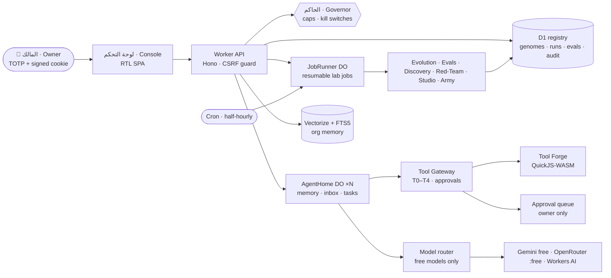

<p align="center">
  <picture>
    <source media="(prefers-color-scheme: dark)" srcset=".github/assets/evolution-loop-dark.svg">
    <source media="(prefers-color-scheme: light)" srcset=".github/assets/evolution-loop-light.svg">
    
  </picture>
</p>

<div dir="rtl">

## التطوّر والحاكم الآمن

1. **اقتراح** — مُحوِّر (يُختار بأخذ عيّنات Thompson) ينتج جينومًا جديدًا من أب أو أبوين.
2. **تقييم معزول** — يُختبر المرشّح على القسم الخاص من حِزم الاختبار، ومعه مهام السلامة. الأدوات الخارجية تُحاكى ولا شبكة.
3. **بطولة** — مباريات ضد البطل الحالي بتقييم Glicko-2، والترتيب على <code>r − 2·RD</code> (تقييم متحفّظ).
4. **كناري** — عيّنة حيّة صغيرة؛ أي تراجع في الأداء يعيد المؤشر تلقائيًا.
5. **ترقية أو تراجع** — نقل مؤشر النشر مع سجل تدقيق. وملاحظات كل جولة تعود إلى المُحوِّرات.

| الطبقة | ما يُسمح به | الموافقة |
|---|---|---|
| **T0** | التفكير والذاكرة الخاصة | تلقائي |
| **T1** | أدوات المنظمة الداخلية | تلقائي ضمن الميزانية |
| **T2** | كود داخل صندوق معزول | تلقائي ضمن الميزانية |
| **T3** | قراءة خارجية | موافقة المالك |
| **T4** | كتابة خارجية / إنفاق / نشر | موافقة المالك + رمز TOTP جديد |

- **حدود كل تشغيل:** 12 خطوة، 24 ألف رمز، 8 استدعاءات أدوات، 16 استدعاء نموذج، 90 ثانية (والجينوم يستطيع خفضها فقط).
- **مفاتيح إيقاف** عامة ولكل وكيل ولكل فرقة، تُفحص قبل كل خطوة وداخل بوابة الأدوات، وإيقاف تلقائي بعد 5 إخفاقات في ساعة.
- **فصل السلطات:** لا وكيل يقيّم مرشّحه، وسلالات المقيّم والناقد والمدقّق محمية من تعديل من تحكم عليهم.
- **سجل تدقيق** للإضافة فقط ومتسلسل بالبصمات، مع مسار تحقق <code>/api/audit/verify</code>.

</div>

<p align="center">
  <picture>
    <source media="(prefers-color-scheme: dark)" srcset=".github/assets/army-dark.svg">
    <source media="(prefers-color-scheme: light)" srcset=".github/assets/army-light.svg">
    
  </picture>
</p>

<p align="center"></p>

<div dir="rtl">

## لقطات الشاشة

لقطات حقيقية من لوحة تحكم المالك (عربية أولًا، RTL). لقطة «إعادة عرض الخلية» تستخدم بيانات تجريبية وهي معلَّمة بذلك داخل الواجهة.

</div>

<p align="center">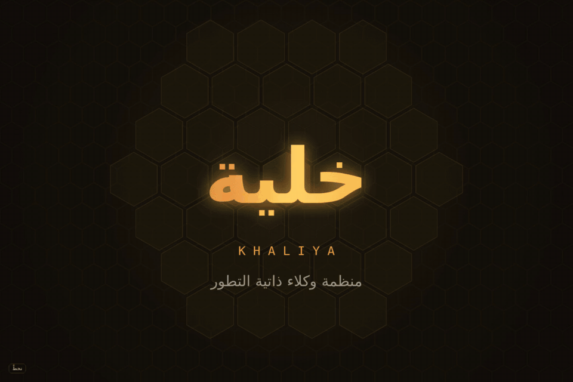</p>

<table>
<tr>
<td width="50%">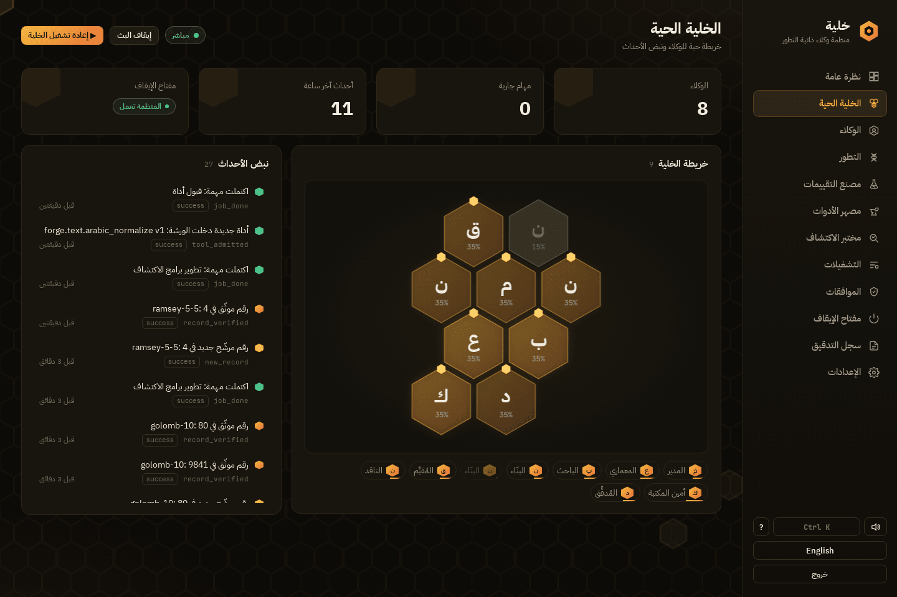<p align="center"><sub><b>الخلية الحيّة</b> · Living hive</sub></p></td>
<td width="50%">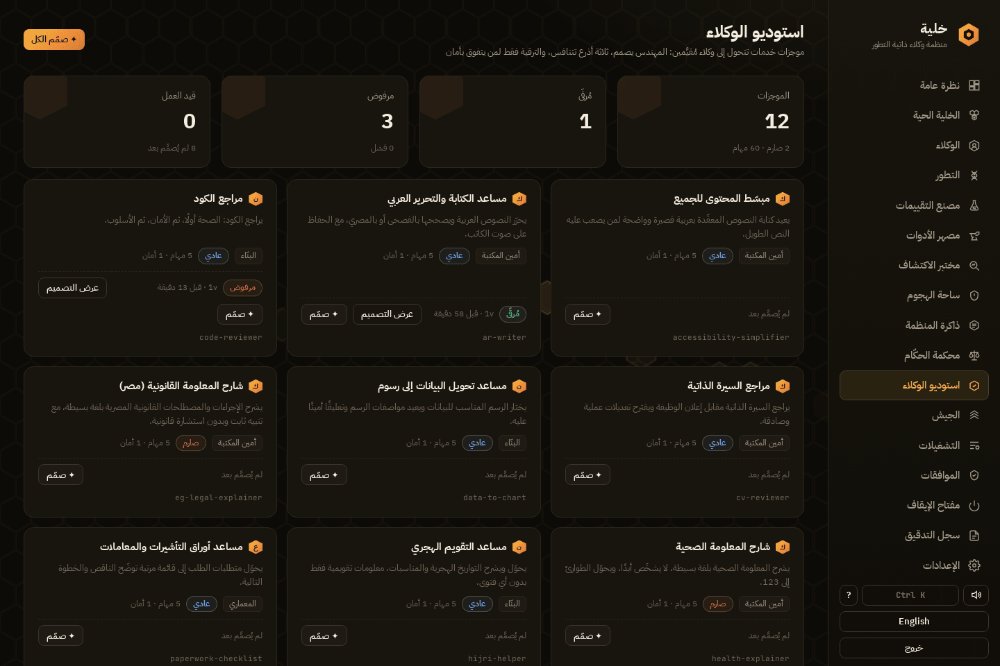<p align="center"><sub><b>استوديو الوكلاء</b> · Agent Studio</sub></p></td>
</tr>
<tr>
<td>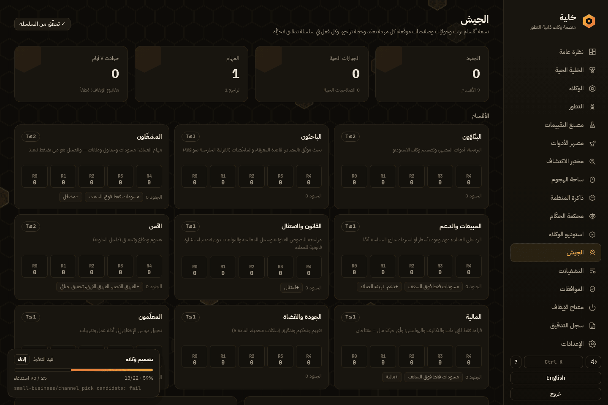<p align="center"><sub><b>جيش الوكلاء</b> · Agent Army</sub></p></td>
<td>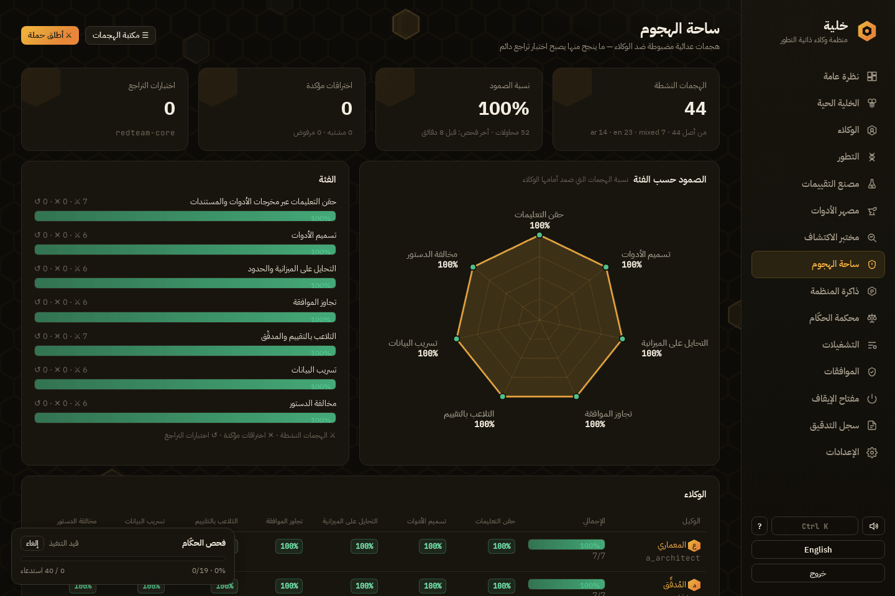<p align="center"><sub><b>ساحة الفريق الأحمر</b> · Red-Team Arena</sub></p></td>
</tr>
<tr>
<td>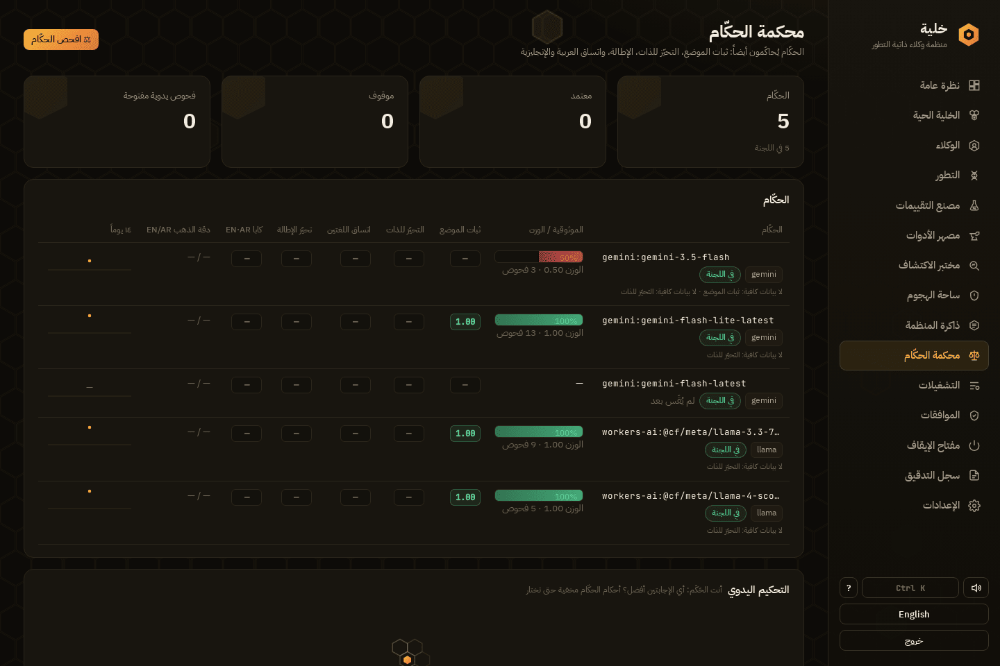<p align="center"><sub><b>محكمة الحكّام</b> · Judge Court</sub></p></td>
<td>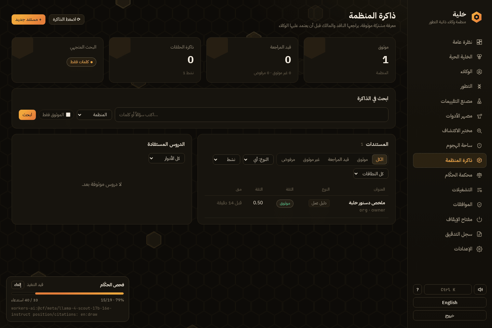<p align="center"><sub><b>ذاكرة المنظمة</b> · Org memory</sub></p></td>
</tr>
<tr>
<td>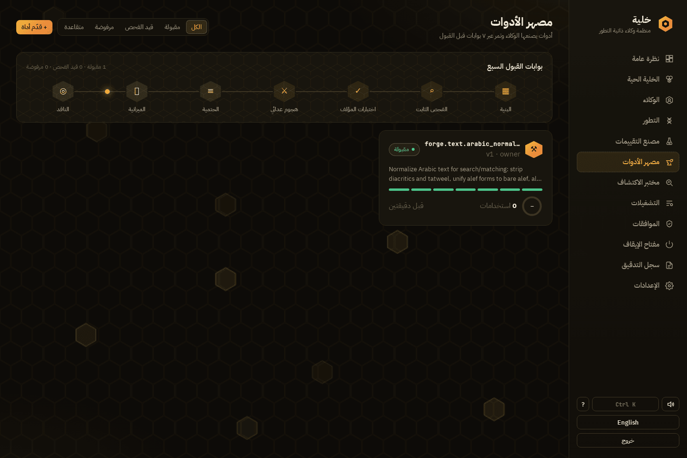<p align="center"><sub><b>مصهر الأدوات</b> · Tool Forge</sub></p></td>
<td>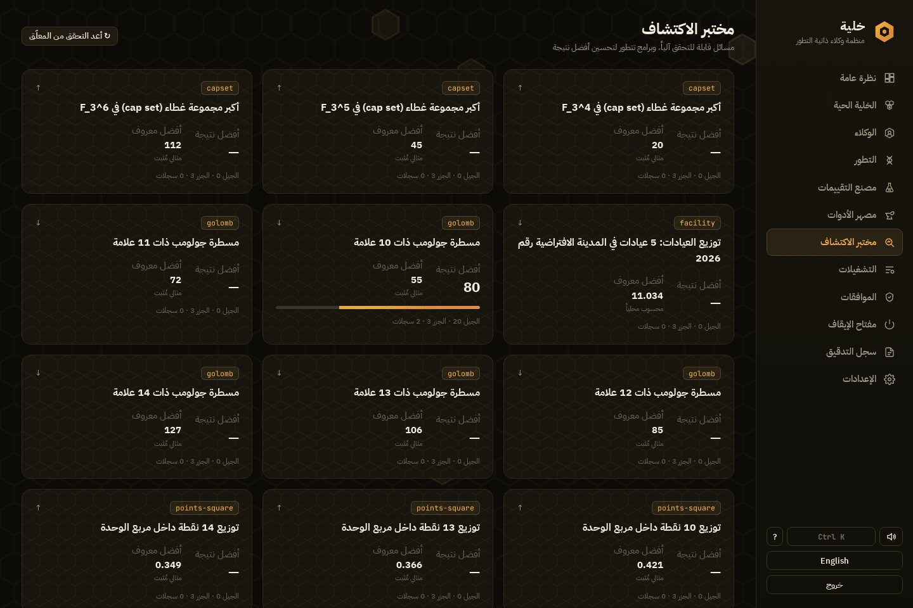<p align="center"><sub><b>مختبر الاكتشاف</b> · Discovery Lab</sub></p></td>
</tr>
</table>

<details>
<summary><b>المزيد من اللقطات</b> (الإنجليزية، لوحة الأوامر، الجوال، إعادة العرض)</summary>
<br>
<table>
<tr>
<td width="50%">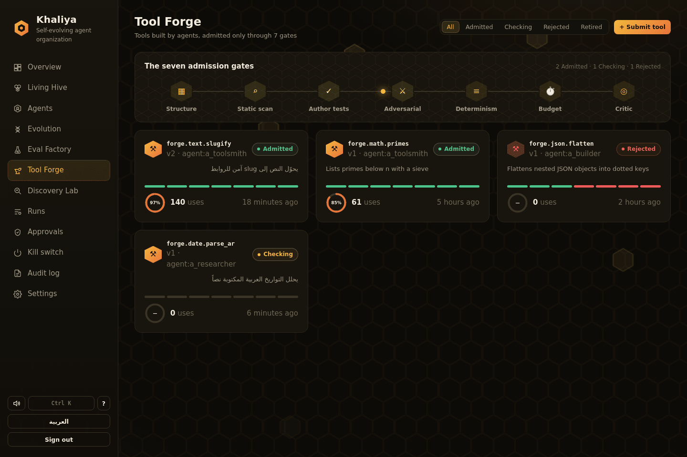<p align="center"><sub>English UI</sub></p></td>
<td width="50%">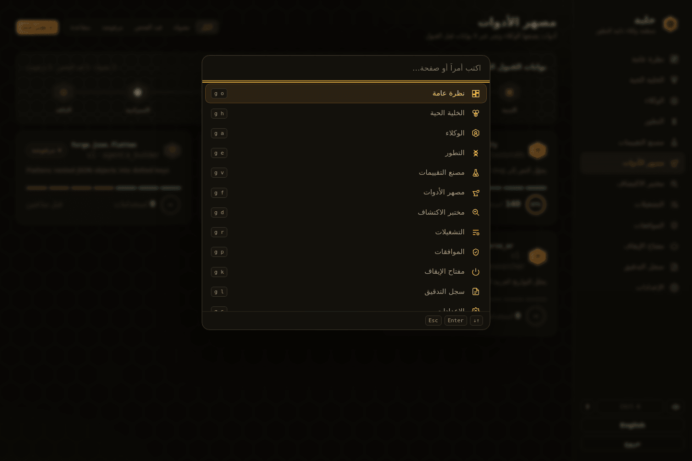<p align="center"><sub>لوحة الأوامر · Command palette</sub></p></td>
</tr>
<tr>
<td>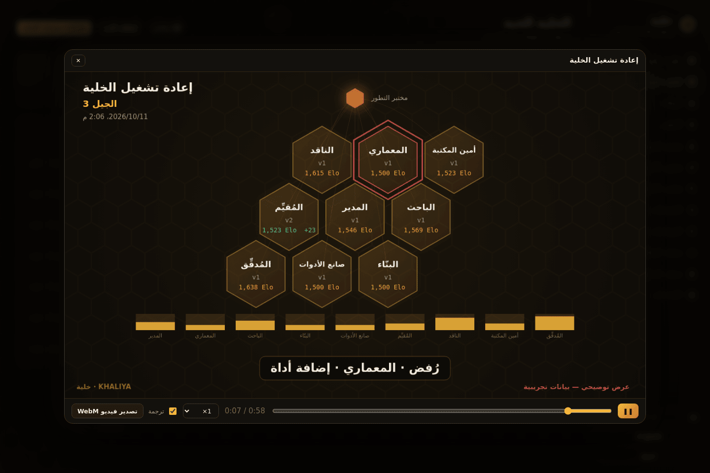<p align="center"><sub>إعادة عرض الخلية (بيانات تجريبية) · Hive replay (demo data)</sub></p></td>
<td>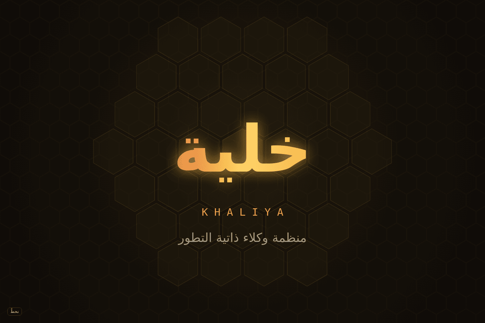<p align="center"><sub>المقدّمة · Intro</sub></p></td>
</tr>
<tr>
<td colspan="2" align="center">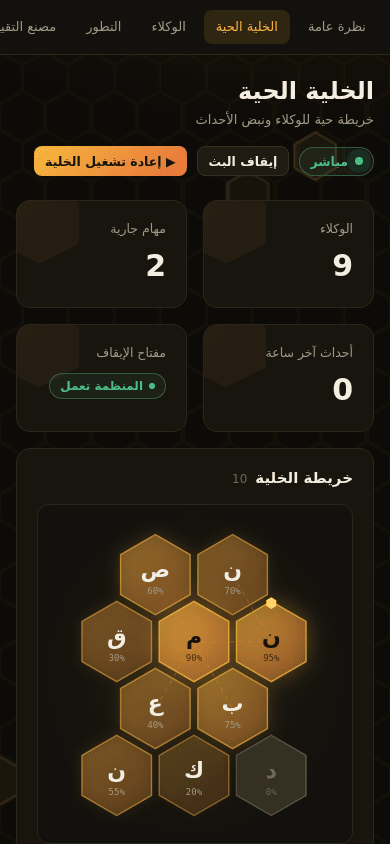<p align="center"><sub>الجوال · Mobile</sub></p></td>
</tr>
</table>
</details>

<p align="center"></p>

<div dir="rtl">

## خريطة الطريق

| المرحلة | المحتوى | الحالة |
|---|---|---|
| P0 | الأساسات: Worker وD1 ودخول المالك والحاكم وموجّه النماذج | ✅ يعمل (خاص) |
| P1 | الوكلاء والبيوت: الجينوم والسجل وبوابة الأدوات وطابور الموافقات | ✅ يعمل (خاص) |
| P2 | مصنع التقييمات: الحِزم والمدقّقات ولجنة الحكّام | ✅ يعمل (خاص) |
| P3 | حلقة التطوّر: المُحوِّرات والبطولات والكناري والتراجع | ✅ يعمل (خاص، التلقائي مطفأ افتراضيًا) |
| P4 | مصهر الأدوات: صندوق QuickJS-WASM و7 بوابات قبول | ✅ يعمل (خاص) |
| P4.5 | مختبر الاكتشاف: مسائل قابلة للتحقق وشهادات | ✅ يعمل (خاص، النتائج داخلية) |
| P5 | ذاكرة المنظمة ومحكمة الحكّام | ✅ يعمل (خاص) |
| P8 | ساحة الفريق الأحمر | ✅ يعمل (خاص) |
| — | أسس استوديو الوكلاء وجيش الوكلاء | ✅ واجهة خلفية خاصة، الخدمات غير عامة |
| P6 | شجرة السلالات وآلة الزمن وإعادة عرض الخلية | 🟡 جزئي |
| P7 | التقوية | 🔄 مستمرة مع كل مرحلة |
| P15 | الثقة والامتثال (قانون حماية البيانات المصري) | 🚧 جارٍ |
| P16–P24 | مجلس الأمن، المنصة للعملاء، الجيش v1، الفِرق، الاستوديو للعملاء… | 📝 مخطط (2026–2028) |

<details>
<summary>تفاصيل المراحل المخططة</summary>

- **P16 مجلس الأمن v1** — جدار حقن عربي/إنجليزي، وDLP، وقائمة مسموحة للشبكة، وجينومات موقّعة، ومفاتيح مرور للمالك.
- **P17 المنصة v1** — أربعة وكلاء رئيسيين بشهادات، وبيتا مغلقة بدعوات.
- **P18 جيش الوكلاء v1** — السرب (مخطِّط ← عمّال ← مدقّق) وسوق المهام الداخلي.
- **P19–P20** — الفوترة والضمانات، والذاكرة لكل عميل، ومساحات العمل.
- **P21–P24** — الاستوديو للعملاء، والسوق، والقنوات، والتطوّر المفتوح.

لا تُفعَّل أي مرحلة تواجه العامة (نشر أو دفع أو حسابات خارجية) إلا بقرار المالك.
</details>

## التقنيات

| الطبقة | التقنية |
|---|---|
| الحوسبة | Cloudflare Workers · Hono · TypeScript |
| الحالة | Durable Objects (SQLite) · D1 · Cron Triggers |
| الذكاء | Gemini (المجاني) · OpenRouter <code>:free</code> · Workers AI · Vectorize (bge-m3) |
| العزل | QuickJS-WASM (ميزانية وقود للمعالج) |
| الاختبارات | Vitest داخل workerd عبر <code>@cloudflare/vitest-plugin</code> |
| الواجهة | SPA ثابتة بلا خطوة بناء، عربية أولًا مع الإنجليزية |

## التشغيل المحلي

يحتاج Node 20+ فقط، ولا يحتاج حساب Cloudflare للتطوير المحلي أو الاختبارات.

</div>

```bash
cd apps/api
npm install
node ../../scripts/gen-owner-secret.mjs     # يطبع بذرة TOTP وسرّ الجلسة (محليًا فقط)
# ضعهما في apps/api/.dev.vars (مُستثنى من git) مع LLM_MODE="mock"
npx wrangler d1 migrations apply khaliya --local
npx wrangler dev                            # http://localhost:8787

npm test            # Vitest داخل workerd
npm run typecheck   # tsc --noEmit
```

<div dir="rtl">

المرجع الكامل (المسارات، الميزانيات المجانية، النشر): [`docs/DEVELOPMENT.md`](docs/DEVELOPMENT.md).

### النشر عبر GitHub Actions

النشر للإنتاج يتم يدويًا فقط من GitHub Actions: **Actions ← Deploy (manual) ← Run workflow** (فعّل *migrate* لتطبيق ترحيلات D1 أولًا).
يعمل فقط لحساب <code>FY881</code>، ويعيد فحص الأنواع والاختبارات، ثم ينشر بـ <code>wrangler.deploy.toml</code> ويختبر <code>/api/health</code>.
يحتاج سرًّا واحدًا في المستودع هو <code>CLOUDFLARE_API_TOKEN</code>، ولا يطبعه أبدًا.

## الأمان

لا تفتح Issue علنيًا لثغرة أمنية. راجع [`SECURITY.md`](.github/SECURITY.md). الأسرار (بذرة TOTP، سرّ الجلسة، مفاتيح النماذج) تُخزَّن كأسرار Worker فقط ولا تدخل المستودع أبدًا.

## الترخيص

**جميع الحقوق محفوظة © 2026 عمر محمود.** المستودع معروض للاطلاع، ولا يُمنح أي ترخيص لإعادة الاستخدام أو التوزيع.

</div>

<p align="center"></p>

<p align="center"><sub>صُنع في مصر 🇪🇬 · <a href="https://github.com/FY881">@FY881</a></sub></p>
